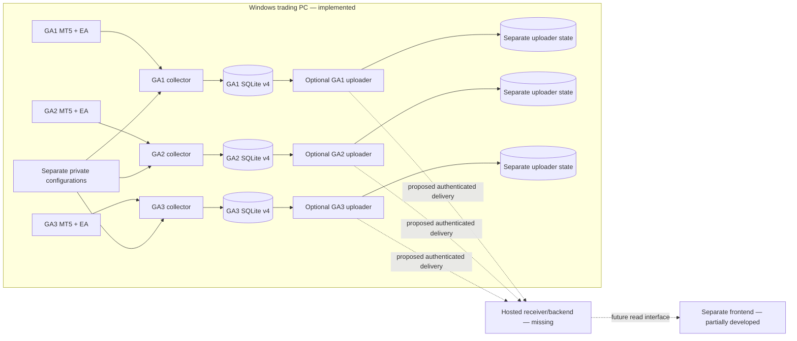

# Gold Algorix MVP Collector Integration Handoff

Prepared 31 October 2026 for the frontend coding agent. MVP target: Monday, 2 November 2026.

Repository implementation checkpoint: `1fb22344ec3e2fa4bbb556204aa1f7692962a810` (`main`). Paths below are relative to this repository. No operational database, private configuration, or MT5 terminal was accessed to prepare this document.

Evidence labels: **Implemented** means established from source; **Reported operational evidence** means supplied by the operator for this handoff; **UNKNOWN / REQUIRES VERIFICATION** means not established here. Implementation capability does not prove operational configuration, running processes, or delivery to a website.

## 1. Executive Overview

Gold Algorix has three demo funds, GA1, GA2, and GA3, each associated with a separate Alpari MT5 demo account and its own Expert Advisor (EA). The EA trades; the Python collector observes the already selected account and persists financial observations and active trade sets. It never calls `mt5.login()` or submits, modifies, or cancels orders.

The Windows collector supplies the raw material for account cards, balance/equity/floating-P&L charts, and positions tables. It is not a portfolio accounting engine, trading controller, or hosted frontend API. The frontend is in a separate repository and was not inspected. No production backend or end-to-end frontend delivery is established.

For Monday's MVP, reuse recorded account observations and current active sets, show source freshness, and label all results as demo-account data. Production availability, validated investment returns, EA attribution, and unattended deployment require additional decisions and evidence; they are not implied by a working collector.

Primary implementation references: `collector.py:run`, `account_reader.py:read_account/read_active_set`, `collector_storage.py:Storage`, and `mt5_monitor.py:checked_account`.

## 2. System Architecture



Each collector sequentially reads account data, positions, and orders. Optional history synchronization shares that collector's MT5 ownership and runs in scheduled slots; it is disabled in the reported demo configuration. SQLite v4 indexes observations/statuses into a durable delivery stream. Independent uploaders are implemented but operational hosting and frontend delivery are not configured or verified. `upload_test_receiver.py` is a loopback test fixture, not the proposed hosted service.

## 3. Repository Structure

| Component | Responsibility / verification entry point |
|---|---|
| `collector.py` | Supported `check` / continuous `record`; guarded connection, cycle, retries, shutdown |
| `account_reader.py`, `mt5_monitor.py` | Account and active-set readers; account/demo guards; older diagnostic CLI |
| `recorder_config.py` | Explicit per-source configuration, default recorder cadence, data-directory validation |
| `collector_storage.py` | Schema construction/migrations and transactional observations, statuses, active sets |
| `terminal_lock.py`, `collector_preflight.py` | Cooperating-process ownership and offline source-set validation |
| `history_config.py`, `history_sync.py`, `history_storage.py`, `deal_reader.py` | Optional bounded deal import, reconciliation, revisions, scheduling |
| `report_time.py` | Explicit UTC/Asia/Tehran presentation and separately verified broker mappings |
| `collector_inspect.py` | Offline SQLite summary/JSON/CSV inspection, including history |
| `delivery_stream.py`, `upload_contract.py`, `upload_reader.py` | v4 delivery index; v1 wire validation; bounded read-only serialization |
| `uploader.py`, `upload_config.py`, `upload_http.py` | Independent uploader engine, config and transport |
| `upload_state.py`, `upload_integrity.py`, `upload_lock.py` | Durable pending/progress, restore/content checks, uploader locks |
| `upload_status.py` | Offline collection freshness, backlog, acknowledgement visibility |
| `upload_test_receiver.py` | Local HTTP ingestion/deduplication fixture only |
| `.env.example`, `uploader.example.json`, `receiver.example.json` | Safe templates, not deployed configuration |
| `continuous_monitor.py` | Older in-memory console monitor; not the durable recorder |
| `docs/` | Existing handoff, delivery contract, uploader operation and status semantics |
| `tests/` | Fake-MT5, temporary SQLite, cross-process lock, time mapping, delivery and loopback tests |

Read `docs/DEVELOPER_HANDOFF.md`, `docs/upload-contract.md`, `docs/uploader.md`, and `docs/uploader-status.md` alongside this document. Relevant test modules include `test_recorder`, `test_active_sets`, `test_multisource`, `test_history`, `test_report_time`, `test_delivery`, `test_uploader`, and `test_upload_status`.

At preparation, `README.md` and `requirements.txt` contain unrelated unstaged changes; `.vscode/`, `dashboard.py`, `static/`, and `tests/test_dashboard.py` are untracked. These experimental dashboard assets are **not part of the committed supported collector release**. README dashboard instructions do not establish a production API. Use committed dependencies and collector modules when assessing the supported path.

## 4. MT5 Data Collection

`AccountObservation` and `read_account` in `account_reader.py` collect:

| Data | Local storage / meaning |
|---|---|
| Balance, equity, floating P&L | `observations.balance`, `equity`, `profit` (REAL) |
| Margin, free margin, margin level | `margin`, `margin_free`, `margin_level` (REAL); preserve broker units |
| Credit | `credit` (REAL) |
| Currency | `source.currency`; also in active-batch binding |
| Private account/server identity | `source.login` (INTEGER), `source.server` (TEXT); not public wire fields |
| Public fund/source identity | `source.fund_id`, `source.source_id` (TEXT) |
| Observation interval | `observations.started_at`, `ended_at` (UTC ISO text from PC clock) |
| Collection status | Separate `status_events`; no stored permanent “live” flag |

Financial values are converted to floats and checked for finiteness. `checked_account` verifies expected login/server and demo trade mode. `read_account` checks broker connectivity, reads/guards the account twice, checks currency stability, and rechecks connectivity. These calls do not guarantee broker-atomic data.

`recorder_config.load_recorder_config` uses the selected file exclusively, rejects duplicate keys and unresolved placeholders, and defaults the recorder interval to five seconds. The shared config constrains a configured interval to positive finite values up to 60 seconds. Older monitor defaults differ; do not apply their one-second default to the recorder.

`collector.run` acquires terminal and optional data-directory locks, plus a database lock for recording. It initializes the explicit executable without credentials, verifies the actual configured data directory, and never switches accounts. `initialize` may launch a closed terminal. `shutdown` releases the Python connection, not the terminal or EA.

Ordinary collection errors retry with waits of 1, 2, 4, … capped at 30 seconds, releasing/reinitializing the connection. Identity failures stop the process; storage failures are fatal. Once storage is bound, retry failures append `retrying` statuses without fabricating observations. Initial failures before binding are console-only. Successful cycles reset the failure counter. Cadence subtracts work time from the interval, but synchronous MT5 calls/history queries can overrun it; there is no hard five-second guarantee.

Freshness must be computed from observation age and status, independently for account, positions, and orders. Retain the last successful value with an explicit stale/failure indication. A historical `saved` status or recent receiver receipt alone does not prove a running collector or healthy EA.

## 5. Positions and Orders

`read_active_set` calls `positions_get()` / `orders_get()`, validates unique integer tickets and JSON-safe records, and retains the entire returned named-tuple dictionary. Local records therefore preserve MT5 fields, including future extra fields. Only `ticket` and serializability are structurally required by this local reader; the outbound contract is stricter.

| Dataset | Important retained MT5 fields when supplied |
|---|---|
| Positions | ticket, identifier, symbol, type, volume, price_open/current, sl, tp, profit, swap, time/time_msc, time_update/time_update_msc, magic, reason, comment, external_id |
| Orders | ticket, position_id, position_by_id, symbol, type/state, volume_initial/current, price_open/current/stoplimit, sl, tp, setup/done/expiration times, magic, reason, comment, external_id |

`Storage.save_cycle` commits an account observation, cycle, saved status, batches, and their records together. Each dataset has its own observation interval and outcome. `success` with `item_count=0` is a valid empty set. `failed` or `identity_mismatch` has null count and no records; a missing dataset is not an empty set. An identity failure may save the already valid account and rejection batch before stopping. Ordinary active-set failure does not prevent saving the account.

To find a latest successful set, filter `active_batches` by dataset and `outcome='success'`, order by parsed `ended_at` descending with a deterministic ID tie-breaker, then join `active_records` by `batch_id`. Also inspect the latest attempted batch: an older successful set must not conceal a newer failed read. Replace whole displayed sets rather than merging tickets across observations. Successful empty snapshots clear prior rows. Show separate snapshot ages, currency and symbol; do not invent type-enum mappings without checking MT5 semantics.

## 6. Historical Deals and EA Attribution

`HistoryConfig.enabled` defaults to false. Enabling requires an explicit whole-second UTC `HISTORY_START_UTC`; changing the retained start is rejected. `HistorySync.tick` schedules bounded initial import, recent refresh, and explicit reconciliation fairly. Failures do not advance progress; slow/oversized queries shrink chunks and can suspend history. State survives restart.

`deal_reader.read_deals` guards identity/connectivity before and after `history_deals_get`. Required fields include ticket, order, time, time_msc, type, entry, magic, position_id, reason, volume, price, commission, swap, profit, fee, symbol, comment, and external_id. It retains non-trading balance/credit/correction operations as well as trading deals. Integer identifiers become exact decimal strings. `HistoryStore.accept` upserts current deals and appends revisions, query membership, omission/reappearance evidence; missing does not mean deleted or a realized loss. Successful query coverage does not prove complete broker history.

**Reported demo history is disabled.** Repository evidence describes an isolated GA1 history test, not verified ongoing synchronization for all sources. Broker event epochs and query-boundary interpretation remain unverified. `report_time.TimeMapping` keeps event/query bases separate and gates verified Tehran trade-day filtering. Never guess an offset from the broker's current wall clock.

Magic, comment, reason, and linked order/position IDs enable investigation, but no verified GA1/GA2/GA3 EA attribution rule is established. Account totals include all activity, deposits, withdrawals, credit and other adjustments. Netting, manual activity and broker metadata can complicate attribution. **The v1 uploader drops magic/comments/reason/external IDs and does not send historical deals.** EA-only tables or performance cannot be derived from that wire payload alone.

## 7. SQLite Database Schema

Schema version is `PRAGMA user_version=4`; it is distinct from contract v1 and uploader-state v1. Definitions: `Storage.__init__`, `history_storage.create_schema`, `delivery_stream.create_schema`.

| Table | Columns and keys |
|---|---|
| `source` | fund_id TEXT, source_id TEXT, login INTEGER, server TEXT, currency TEXT, all NOT NULL; code requires one exact binding row, no declared primary key |
| `observations` | observation_id TEXT PK; started_at/ended_at TEXT; balance/equity/profit/credit/margin/margin_free/margin_level REAL, all NOT NULL; nullable cycle_id TEXT added in v2 |
| `status_events` | event_id TEXT PK; started_at/ended_at/status TEXT NOT NULL; nullable detail TEXT |
| `cycles` | cycle_id TEXT PK; started_at/ended_at TEXT NOT NULL |
| `active_batches` | batch_id TEXT PK; cycle_id TEXT NOT NULL REFERENCES cycles; dataset TEXT checked positions/orders; fund_id/source_id/server/currency TEXT and login INTEGER NOT NULL; started_at/ended_at TEXT; outcome TEXT checked success/failed/identity_mismatch; nullable item_count INTEGER/detail TEXT; UNIQUE(cycle_id,dataset) |
| `active_records` | batch_id TEXT REFERENCES active_batches, ticket TEXT, payload_json TEXT; all NOT NULL; PK(batch_id,ticket) |
| `history_state` | source_id TEXT PK; start_utc TEXT, chunk_seconds INTEGER; turn, slow_count, suspended INTEGER default 0; next_slot_due REAL default 0; non-key fields NOT NULL |
| `history_jobs` | job_id TEXT PK; kind TEXT; range_start/range_end/cursor INTEGER; next_due REAL default 0; failures INTEGER default 0; non-key fields NOT NULL |
| `history_queries` | query_id TEXT PK; job_id/source_id TEXT; range_start/range_end INTEGER; started_at/ended_at/outcome TEXT; duration_seconds REAL, required; nullable item_count INTEGER/detail TEXT |
| `deals` | source_id/ticket TEXT composite PK; time_msc INTEGER; payload_json/payload_hash TEXT; revision INTEGER; first_seen/last_seen TEXT; missing INTEGER default 0; all NOT NULL |
| `deal_revisions` | PK(source_id,ticket,revision); source_id/ticket TEXT, revision/time_msc INTEGER, payload_json/payload_hash/observed_at/query_id TEXT; all NOT NULL |
| `history_query_members` | query_id/ticket TEXT, revision INTEGER, all NOT NULL; PK(query_id,ticket) |
| `history_discrepancies` | event_id TEXT PK; source_id/ticket/query_id/observed_at/kind TEXT NOT NULL |
| `delivery_stream` | singleton INTEGER PK CHECK(singleton=1); stream_id TEXT NOT NULL UNIQUE |
| `delivery_events` | sequence INTEGER PK AUTOINCREMENT; kind TEXT checked account_observation/collection_status; record_id TEXT; required; UNIQUE(kind,record_id) |

Explicit history indexes: `deals_time(time_msc)` and `history_queries_time(started_at)`. Primary/unique keys also generate SQLite indexes where applicable. AUTOINCREMENT creates SQLite bookkeeping; that is not a business table. No observation-time index is declared. History links, observation cycle links and delivery record links are largely application-maintained; do not assume every logical relationship has an enforced foreign key. `Storage` does not enable `PRAGMA foreign_keys`.

Account observations relate to cycles via `cycle_id`; legacy observations may have none. Cycle → dataset batch → ticket records reconstructs an active set. Delivery events reference either observations or statuses according to `kind`; active batches are embedded through their observation's cycle, not independent delivery events. Historical deals are not indexed into the delivery stream.

Migration accepts 0/1/2/3/4 and rejects unsupported versions; an existing unversioned nonempty database is rejected. v4 creation/backfill/triggers and user_version commit in one transaction, rolling back on error. Existing observations, statuses, active sets and history remain. Backfill sorts ended_at text, kind and record ID; this is deterministic transport order, not reconstructed commit chronology. `AFTER INSERT` triggers add observation/status events atomically. Reopening v4 preserves stream identity. Frontend reads must never instantiate `Storage`, which can create directories, write and migrate.

Representative **read-only query patterns**, not a new public interface:

```sql
SELECT observation_id, started_at, ended_at, balance, equity, profit,
       credit, margin, margin_free, margin_level
FROM observations
ORDER BY julianday(ended_at) DESC, observation_id DESC LIMIT 1;

SELECT batch_id, ended_at, outcome, item_count
FROM active_batches
WHERE dataset = ? AND outcome = 'success'
ORDER BY julianday(ended_at) DESC, batch_id DESC LIMIT 1;
```

Use parameterized dataset/range inputs, short read transactions, explicit source binding and `mode=ro`. Query latest attempted batches separately. Timestamp maximum is a display convention, not proof of chronological commit order when the PC clock steps. Bound chart ranges and results; no existing chart pagination/downsampling API is supplied.

## 8. Data Available for Frontend Charts

“Available” describes stored inputs, not an implemented website API or guaranteed current values.

| Feature | Readiness / source | Current vs history / calculation / limits |
|---|---|---|
| Current balance | Available: observations.balance | Latest persisted value; freshness required |
| Current equity | Available: observations.equity | Same |
| Floating P&L | Available: observations.profit | Account-level, not realized trading return |
| Balance-over-time | Available: observations + intervals | Since collection began; preserve gaps; no earlier reconstruction |
| Equity-over-time | Available: observations + intervals | Same; sampling can miss intracycle extremes |
| Floating-P&L chart | Available: observations.profit | Same; unchanged values still valid observations |
| Margin/free margin | Available: margin/margin_free | Stored history and latest values |
| Margin level | Available: margin_level | Preserve broker semantics, including zero values |
| Credit/currency | Available: credit/source.currency | Currency bound per source; no FX conversion layer |
| Open positions | Available: latest successful positions batch | Display complete set with age and latest read outcome |
| Pending/active orders | Available: latest successful orders batch | Interpret order type carefully; successful empty valid |
| Historical trades | Partial: deals/revisions locally | Disabled reported configuration; time/coverage unresolved; not uploaded |
| EA-only trades | Unverified | Metadata local only; no verified EA mapping |
| Percentage returns | Missing validated calculation | Cash-flow treatment, baseline and period require definition; balance delta is not return |
| Drawdown | Missing validated calculation | Sampled equity inputs exist; methodology and missing-period policy unresolved |
| Win rate/profit factor/trade count | Missing validated calculation | Requires deal-to-trade reconstruction, costs, partial closes and attribution policy |
| Freshness / connection indicator | Partial reusable status | Derived age/status; not live EA health or remote reachability |

Do not fabricate performance history to fill collection gaps. Any synthetic demo series must be visibly labeled and kept separate from measured data.

## 9. Multi-Account Architecture

Use one explicit private config, terminal installation/data directory, collector process and SQLite file per source. `FUND_ID` and `SOURCE_ID` are stable aliases, not account numbers; their exact deployed values are intentionally omitted. Do not assume their spelling equals a frontend URL slug without an approved mapping. GA1/GA2/GA3 are business labels. `source` binds aliases to expected login/server and observed currency; the reported live checks found USD, not a promise about future sources.

`collector_preflight.check_configuration_set` rejects duplicate terminal/data/database paths, fund IDs, source IDs and account/server pairs. It checks existing source bindings and schema without migrating, requires history disabled for preparation, and refuses nonempty WAL/journal state. It is offline; it does not verify the active demo account or broker connection. Runtime `check` verifies those separately.

Terminal/database/data-directory locks coordinate participating processes under the same Windows user/temp environment. They do not stop unrelated clients, different users or older versions without guards. Config-set uniqueness is not a global identity registry. Future ingestion must bind each authenticated source to its expected fund/currency and stream, reject cross-source mixing, and preserve identity through storage, queries and frontend state.

## 10. Delivery Stream and Uploader

References: `delivery_stream.create_schema`, `upload_reader.read_delivery`, `upload_contract.serialize_request/validate_request/validate_acknowledgement`, `Uploader.step`, `UploadState`, `upload_integrity.snapshot`, `upload_http.post`.

Each source has a persistent stream UUID and increasing AUTOINCREMENT sequence. Sequences are not gap-free; backlog is an actual count after the acknowledged cursor. A request carries contract_version=1, batch_id, public source, stream_id, first_sequence, last_sequence and events. All sequences and broker identifiers are decimal strings for JavaScript precision. Request limits are 1–20 events and 512 KiB canonical JSON. Account events contain seven financial fields, UTC observation intervals, optional cycle, active_batches and absent_datasets; status events contain sanitized status only.

Positions on the wire include ticket/identifier, symbol/type, volume, price_open/current, sl/tp, profit/swap and unverified raw broker times. Orders include ticket/position_id/position_by_id, symbol/type, volume_initial/current, price_open/current/stoplimit, sl/tp and unverified raw times. Unknown/private fields are rejected or dropped by allowlisting. Login/server, comments, magic, reason, external IDs, arbitrary error details and terminal paths are excluded. Local full-payload retention does not imply wire availability.

The uploader has separate state schema v1: `control(singleton,binding,progress)` and `pending(singleton,batch_id,first_sequence,last_sequence,digest,payload)`. It persists exact bytes and SHA-256 before HTTP. Only a full `committed` acknowledgement matching contract/batch/source/stream/digest/final sequence advances progress atomically and removes pending bytes. Lost responses replay identical bytes/batch IDs. Delivery is at least once; a receiver must transactionally deduplicate stable records and stream sequence mappings, reject content conflicts, persist the acknowledgement, then reply. Digest is not authentication.

Source-specific bearer authentication and verified HTTPS are implemented client expectations. HTTP is allowed only for explicit loopback test mode. Redirects are rejected. Default socket timeout is 10 seconds, attempt watchdog 30 seconds; DNS resolution is not strictly bounded by that watchdog. Transport errors, selected server errors and 429 retry with durable exponential/jitter scheduling; permanent/auth/conflict/invalid-ack errors pause. Active waits use monotonic time; persisted restart waits account conservatively for clock uncertainty. `--resume` is an explicit revalidation/retry, never a cursor reset.

Bindings include source, destination, stream and collector file identity; acknowledged and pending content anchors detect some restores/divergence. They do not audit every historical record or prove never-seen data existed. Preserve collector and uploader-state backups together once delivery is operational. Do not reset progress, skip malformed events or delete pending requests to unblock delivery.

Read budgets: 100 ms SQLite busy timeout, cooperative one-second query budget, maximum 10,000 active records per set and 1 MiB raw JSON per record. Oversized sets/events pause rather than truncate. No SQLite read transaction is held across HTTP. An invalid earlier delivery event can block draining later events; whether any such event exists operationally is **UNKNOWN** here. New interval validation does not retroactively repair legacy rows.

`upload_status.status` separates collection freshness, delivery backlog/pending/retry, and historical receiver acknowledgement. JSON status v2 and console text are available; current receiver reachability is always `not_checked`. Local tests cover loopback delivery, lost-response replay, restart, concurrent recording, bindings/conflicts and visibility. External HTTPS/hosted receiver interoperability remains unverified. No deployed ingestion service or frontend flow is established.

## 11. Existing Data Access Interfaces

| Interface | Returns / access | Bounds and integration implications |
|---|---|---|
| `collector_inspect.read_database(path, mapping)` | Source, observations, status_events, active_batches, decoded active_records; direct read-only SQLite v3/v4 | Loads entire tables; no explicit shared transaction or bounded live-view budget. Avoid frequent frontend polling; output includes private identity/full metadata |
| `collector_inspect.read_history(...)` | Allowlisted history table, decoded payloads and mapping metadata; JSON/CSV/summary CLI | Limit 1..100000, default 1000; optional ranges; not a full chart service; verified event mapping required for Tehran day filters |
| `upload_reader.read_delivery(...)` | Public source, stream, ordered events, pending_count and other stream metadata; direct read-only v4 snapshot | At most 20 selected events plus checked anchors; budgets above; reusable for ingestion, not an arbitrary historical-chart query interface |
| `upload_status.status(config, ...)` | Collection/delivery/receiver status; direct read-only collector/state metadata and bounded anchor checks | No financial series; no network/MT5; requires uploader-style config; total unsent bytes unknown |
| `collector.py check` | Console connection/demo verification and currency | Calls MT5; not a web request handler or data export |
| `collector_preflight.py` | Offline config-set errors/notes | Preparation only, not live monitoring; uses immutable reads only under stopped-writer assumptions |

`collector_inspect.py` CLI supports `--format summary|json|csv`, `--csv-table observations|status_events|active_batches|active_records`, and `--history-table` with range/limit options. `--output` writes an export and must point to private storage if used operationally. Exports are not safe public responses without filtering. `uploader.py check/status --format text|json` are offline; `once/run` perform delivery and write separate state.

Illustrative **partial wire event**, fictional values; this excerpt omits required fields and is not a valid standalone request:

```json
{
  "sequence": "101",
  "kind": "account_observation",
  "record_id": "example-observation",
  "started_at_utc": "2026-01-01T00:00:00Z",
  "ended_at_utc": "2026-01-01T00:00:00.100000Z",
  "account": {"balance": 1000, "equity": 1001, "profit": 1,
    "credit": 0, "margin": 10, "margin_free": 991, "margin_level": 10010}
}
```

Use the full fictional request in `docs/upload-contract.md` for contract implementation. There is no supported public REST data server in the committed collector path.

## 12. Operational Deployment

The trading PC uses separate MT5 installation and data directories, private per-fund environment files and private per-fund databases. Do not copy real paths or account details into source control. Committed `requirements.txt` pins `MetaTrader5==5.0.6231` and `tzdata==2026.6`; use `.venv\Scripts\python.exe`, never global dependency installation. Uncommitted dashboard dependencies are separate.

Supported operator commands (generic placeholders, **not instructions to execute during integration assessment**):

```powershell
.\.venv\Scripts\python.exe collector_preflight.py --config C:\private\ga1.env --config C:\private\ga2.env --config C:\private\ga3.env
.\.venv\Scripts\python.exe collector.py check --config C:\private\ga1.env
.\.venv\Scripts\python.exe collector.py record --config C:\private\ga1.env
```

Use one persistent visible console per collector, Ctrl+C to stop cleanly, and confirm the intended terminals are already open. The process is not installed as a service or scheduled task. Closing its console or restarting Windows can interrupt collection; no automatic restart is supplied. Do not assume a short-lived agent tool session will preserve a child collector or provide operator control. Do not run another dashboard/monitor as an additional connection owner alongside these collectors.

Observe advancing counts and timestamps over several cycles, recent statuses and successful active batches. Unchanged financial values are acceptable during closed markets. A 30-second freshness target is a local heuristic, not an SLA. Keep stale data labeled and inspect each source independently.

Before operational schema upgrades: stop recording safely, use SQLite's backup API, verify the separate backup's integrity/schema/source/record preservation, obtain explicit authorization, then verify migration retention and resumed cycles. Do not blind-copy an active WAL database, delete sidecars, change journal mode for a frontend, or instantiate writer/migration classes from web requests. Short `mode=ro` reads coordinate with active SQLite writers; do not use `immutable=1` against a changing database. Backup API handles committed WAL content. Preserve failed backups/affected databases for review; never automatically overwrite with a restore.

## 13. Current MVP Verification Status

**Reported operational evidence supplied for this handoff:** all three sources were backed up at v3, passed offline preflight and live demo identity/connection checks, then migrated to v4 and recorded increasing observations. Latest reported historical counts were GA1 **211**, GA2 **66**, GA3 **52**, with successful positions/orders snapshots. These are sample counts, not financial performance or current process status. The new migration/startup evidence is operator supplied and was not independently re-read from operational files for this documentation task.

Repository README M4 evidence separately records simultaneous collection and isolation during a GA2-only stop/restart. Repository M3 evidence records an isolated GA1 historical import, with unresolved broker time semantics. The older developer handoff reports 146 tests passing (141 with dashboard imports blocked); these are recorded prior test results, not tests rerun here and not proof of production readiness.

**Not verified here or established as complete:** current running processes; long-term unattended availability; hosted ingestion; frontend integration; production deployment; ongoing time-correct historical synchronization; EA-specific returns; populated active-order live coverage; full failure/recovery behavior against live broker connectivity. Reported live checks do not prove all of these.

## 14. Known Limitations and Risks

| Priority for MVP | Risk / required handling |
|---|---|
| Immediate | No backend/frontend delivery exists yet; charts cannot read the private Windows SQLite files directly from a public browser |
| Immediate | Collection age, delivery backlog and receiver receipt are independent; expose uncertainty/staleness rather than a single misleading live badge |
| Immediate | PC clock diagnostics previously showed about 44.7 seconds ahead of independent UTC and unsynchronized clock status; no current correction is established. Preserve signed ages/future flags |
| Immediate | Historical gaps and short source histories are real; no reconstructed pre-collection equity or fabricated continuous series |
| Immediate | Legacy reversed intervals or other invalid stored events, if present, can stop serialization; operational prevalence UNKNOWN. Do not skip/repair without review |
| MVP feature-dependent | Raw broker event times and historical query mapping unverified; collector observation time is a different concept |
| MVP feature-dependent | Active reads are sequential, not atomic; display their own ages and distinguish empty/failed/absent sets |
| MVP feature-dependent | EA attribution and investment-return methodology unverified; keep account charts separate from claims of EA performance |
| Operational | Console closure, reboot, storage failures, connection interruptions and growing databases can stop or delay data; no service/retention/central alert system exists |

For later production review: real-account authorization, deployment support, availability, disk capacity, backups/recovery, tenant isolation and retention. Do not expand Monday's work into implementing all these mechanisms.

### Documentation differences to retain explicitly

`docs/upload-contract.md` initially says no HTTP client/uploader/receiver exists: that describes M5.1, while M5.2/M5.3 modules and later docs implement local uploader/fixture/status capabilities. Likewise older “no operational upgrade” and v3 statements in existing docs are milestone evidence, superseded operationally only by the new operator report, not by code version alone. README contains historical monitor/dashboard instructions and uncommitted dashboard edits; these are not evidence of a hosted backend. Monitor one-second cadence differs from recorder five-second default. Local full metadata differs deliberately from the wire allowlist. No discrepancy was repaired in this task.

## 15. Integration Considerations for Claude

Inspect the actual frontend before deciding its data contract. Inventory GA1/GA2/GA3 fund pages and shared overview widgets, historical charts, current account cards, positions/orders lists, and any performance claims. Preserve source identity through navigation, caching and asynchronous updates; never let a response for one fund populate another.

Questions to answer from the frontend repository:

1. Which components still use placeholders, and which fields/units/ranges do they expect?
2. Do charts require raw observations, time buckets, period selectors, or downsampling? What gaps and baseline dates should be visible?
3. Which views need only account totals, and which need positions, orders, historical deals or unavailable EA attribution?
4. Is roughly five-second source sampling sufficient? What browser polling/streaming method fits the host and load? Faster refresh cannot create new source samples.
5. How should each component render missing, stale, retrying, stopped, future-dated and successful-empty states?
6. Which timestamps need UTC storage and explicit Asia/Tehran display? Are labels confusing observation, broker event and backend receipt times?
7. What are the public/private access requirements? Server-side ingest secrets must never enter browser bundles or responses.
8. Are percentages, drawdown or win rates displayed without an agreed validated methodology? Remove or label unavailable rather than derive unsupported claims.

All performance labels must identify demo accounts. Preserve decimal-string identifiers in JavaScript; do not round-trip tickets/sequences through Number. Decide display precision without implying accounting-grade decimal arithmetic from SQLite REAL. Any frontend synthetic data must remain visibly separate.

## 16. Backend Architecture Decision Points

| Approach | Already available | Required work / deployment and security | MVP tradeoff |
|---|---|---|---|
| A. Durable uploader + minimal hosted receiver/backend | v1 validated payloads, per-source delivery stream, durable replay/progress, HTTPS client, loopback receiver semantics | Provision source authentication; implement transactional ingestion/dedup/conflicts/ack; persist account/active history; implement authorized frontend reads and freshness; host securely | Reuses strongest delivery work; requires contract-correct receiver. Historical deals and EA metadata are not transported |
| B. Local read API or explicit periodic publication | SQLite observations/active sets, inspection/read helpers | Build bounded sanitized reads or incremental exports, source mapping, access control, safe networking/publication and destination storage; define restart/dedup/failure behavior | May reduce MVP surface for a suitable environment; reachability, security and reliable publication remain real work |

Neither option lets a public website directly open SQLite on the private trading PC. A local API requires a deliberately secured access/network arrangement; periodic upload needs an authenticated destination and a freshness policy. The test fixture is not a deployment shortcut. Do not choose a route, framework, host, polling method or authentication design without checking the frontend and deployment constraints. FastAPI is a stated future project direction, not implemented functionality. No approach should introduce MT5 reads into browser request handling or tie uploader failure to local collection.

## 17. Recommended Claude Assessment Workflow

1. Read this handoff and linked contract/operation documents.
2. Inspect the separate frontend repository and deployment constraints.
3. Inventory components, expected fields, periods, precision and update behavior.
4. Match each requirement to local data and separately to wire-delivered data.
5. Identify missing mappings, sanitization, transformations and unsupported metrics.
6. Define backend ingest/storage/read/freshness/security responsibilities.
7. Compare the smallest feasible architecture and deployment for Monday.
8. Produce a concrete integration proposal before implementation, separating required MVP changes from later improvements. Request operational authorization separately for any collector/uploader/configuration changes.

## 18. Integration Readiness Summary

**Ready:** guarded independent collectors; persistent account series; complete active snapshots with explicit outcomes; v4 stream; bounded sanitized serialization; durable uploader implementation; local inspection/status; reported successful three-source demo collection.

**Partially ready:** reusable data-access building blocks, historical deals, source freshness presentation, backend ingestion contract, and recovery mechanisms. These need integration and operational validation; current live status is UNKNOWN.

**Missing:** hosted receiver and frontend read service, deployment/source provisioning, actual frontend wiring, chart query/range transformations, validated performance calculations and verified EA attribution.

**Can be deferred if absent from Monday's scope:** EA-only performance, time-correct deal reports, complex statistics, automated service deployment, centralized alerts and retention. Preserve existing data meanwhile.

**Claude must decide after frontend inspection:** the minimal field/view contract, source mapping, update and staleness behavior, secure deployment path, and whether reusing durable ingestion or a simpler explicit MVP publication path yields the smallest reviewable integration. Propose those decisions before changing either repository or live operations.
